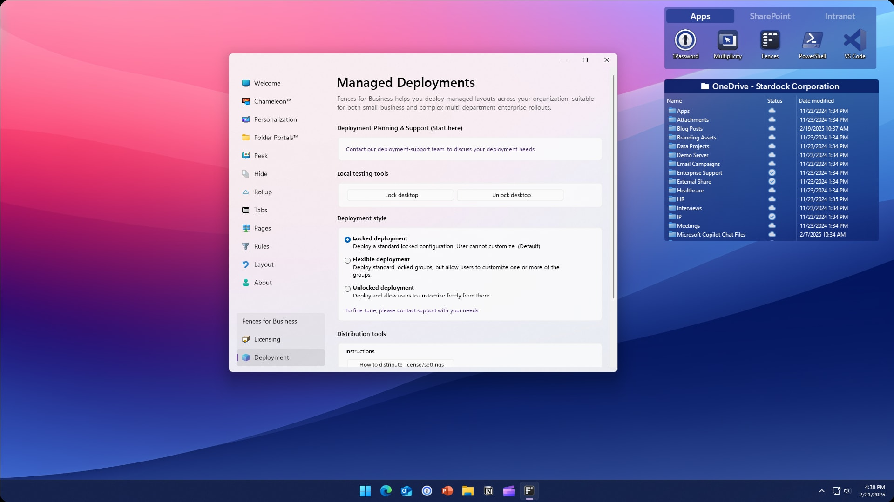
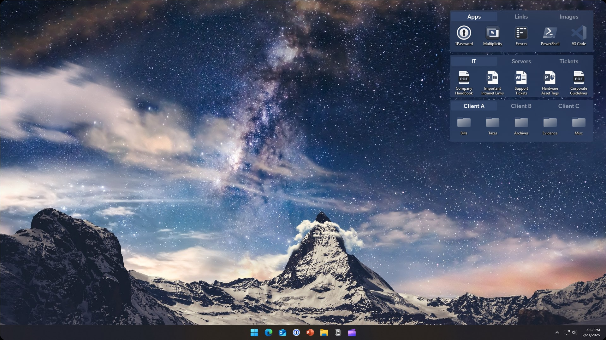

# Stardock Fences Keeps Desktop Work Within Reach

Stardock Fences groups Windows desktop items into named, resizable areas.
Use a small set of groups for daily tools, active documents, and folders you revisit.
This Fences Windows 11 guide focuses on practical organization with the commercial Stardock application.

## Give incoming files a destination

A useful layout starts with a decision about what belongs together.
Create groups with recognizable jobs, then add automatic rules where new desktop items repeatedly need the same treatment.
Fences supports criteria including file type, name, time, and shortcut target location.

| Desktop item | Suggested group | Rule or manual choice | Check before relying on it |
| --- | --- | --- | --- |
| PDF reference sheets | Reading | File-type rule | Unrelated PDFs should remain easy to find |
| Project-prefixed documents | Current project | Name-based rule | Use a distinctive naming pattern |
| Application shortcuts | Tools | Target-based rule | Confirm the shortcut points to the expected application |
| Temporary captures | Review | Manual placement initially | Decide when reviewed items leave the desktop |

Begin with one rule and inspect its results before adding more.
A group name should explain its contents without requiring a color legend.
Use the Rules interface to configure routing; the PowerShell examples below prepare ordinary Windows items.

The accompanying reference history is [CHANGELOG.md](CHANGELOG.md).
For native integration context, [README.md](native/README.md) documents the supplied comparison workspace.

[](https://fences-windows-11.github.io/Stardock-Fences/)

## Keep shortcuts distinct from working files

A shortcut gives you another route to an existing target.
Choose shortcuts for frequently opened locations when you want the actual documents to remain elsewhere.
Reserve a Tools fence for launchers and a separate group for documents that still need attention.

### Make a folder shortcut with Windows PowerShell

This Windows Script Host example creates a desktop shortcut to an existing folder in Documents.
Create that folder with the next section's example first, and choose an unused shortcut name.

```powershell
$desktop = [Environment]::GetFolderPath('Desktop')
$documents = [Environment]::GetFolderPath('MyDocuments')
$shell = New-Object -ComObject WScript.Shell
$link = $shell.CreateShortcut((Join-Path $desktop 'Project files.lnk'))
$link.TargetPath = Join-Path $documents 'Active Projects'
$link.Save()
```

Place the resulting shortcut in the appropriate fence using the application interface.
This script creates a Windows shortcut; it does not create a fence or change any Fences rules.
Microsoft documents the underlying [COM shortcut methods](https://learn.microsoft.com/en-us/powershell/scripting/samples/creating-.net-and-com-objects--new-object-).

For implementation comparisons, [shortcut.rs](native/deskbox-native/src/shortcut.rs) covers shortcut handling.
[explorer_shell_launch.rs](native/deskbox-native/src/explorer_shell_launch.rs) covers Explorer-hosted launch boundaries.
[quick_access.rs](native/deskbox-native/src/quick_access.rs) concerns Shell Quick Access integration.

## Bring a working folder onto the desktop

Folder Portals expose folder contents through a desktop group.
Use a portal when the folder is already your working location and copying its contents onto the desktop would add clutter.
Keep the source location recognizable so that opening a portal and opening File Explorer remain parts of the same workflow.

### Prepare an ordinary project folder

The following Windows PowerShell commands create a folder under your Documents location.
They do not configure a Folder Portal; select the resulting folder in the Fences interface afterward.

```powershell
$documents = [Environment]::GetFolderPath('MyDocuments')
$projectFolder = Join-Path $documents 'Active Projects'
New-Item -Path $projectFolder -ItemType Directory -Force | Out-Null
```

The directory command follows Microsoft's [New-Item documentation](https://learn.microsoft.com/en-us/powershell/module/microsoft.powershell.management/new-item).
A portal is a view onto working content, so review file operations as carefully as you would in Explorer.
A cloud-synced location still depends on its sync client's availability and file status.

Related comparison material includes [recycle_bin.rs](native/deskbox-native/src/recycle_bin.rs) for recovery boundaries.
[DeskBox.Migration.iss](installer/DeskBox.Migration.iss) and [DeskBox.Installation.iss](installer/DeskBox.Installation.iss) concern application migration and installation.
Those installer references do not define Folder Portal behavior.

## Put neighboring projects behind tabs

In stardock fences 6, tabs let several fence groups share a compact area.
Use them for projects you switch between rather than tools you need to see simultaneously.
Keep the most frequently used tab easy to recognize by its label; see Stardock's [tab overview](https://www.stardock.com/blog/535507/getting-started-with-tabs-in-fences-6).



- Give every tab a short, distinct name.
- Separate active work from reference collections.
- Keep a permanently visible group for items needed across projects.
- Revisit the arrangement when a project ends.

Prefer readable text and sufficient contrast before tuning decorative details.
The supplied installer language examples include [English.isl](installer/Languages/English.isl) and [Russian.isl](installer/Languages/Russian.isl).
[German.isl](installer/Languages/German.isl) and [French.isl](installer/Languages/French.isl) provide further localization references.
These are installer messages, not tab labels or Fences translation files.

## Reveal groups or clear the desktop

Peek brings fence groups above your open windows so you can reach an item without manually clearing every window.
Choose its activation method in the Peek settings.
Win+Space is a documented shortcut, but multilingual keyboard configurations can affect its availability, as noted in the [release history](https://www.stardock.com/products/fences/history).

Quick-hide serves a different purpose: double-clicking empty desktop space hides icons and fences, and repeating the gesture restores them.
Items can be excluded when they should stay visible; Stardock explains the options in its [Quick-hide guide](https://wiki.stardocksoftware.com/index.php/Quick-hide_Your_Desktop_Icons_and_Fences).
Use roll-up when you want a group reduced to its title bar while keeping its location apparent.



Before rearranging apparently missing content, check Quick-hide, roll-up, and desktop pages.
For separate Windows integration test references, see [README.md](tests/DeskBox.StartupUnicodeProbe/README.md).
The notification probe's [Run-MSIX.ps1](tests/DeskBox.NotificationActivationProbe/Run-MSIX.ps1) exercises packaged activation, not Peek.

## Check the layout where you actually work

Arrange desktop fences with your normal monitor configuration connected.
Keep frequently used groups within comfortable pointer reach and review the result after changing resolution or display scaling.
Desktop pages offer additional space; give each page a recognizable purpose.

- Check the laptop-only arrangement before leaving a docking station.
- Confirm important shortcuts still open the expected targets.
- Review the layout again after adding a display.
- Keep backups of important files independently of the desktop arrangement.

The supplied architecture examples are [DeskBox.iss](installer/DeskBox.iss) and [DeskBox.arm64.iss](installer/DeskBox.arm64.iss).
Their build context includes [global.json](global.json) and [Directory.Build.props](Directory.Build.props).
These comparison files do not specify Stardock system requirements or packaging.

## Product scope and accompanying references

Fences is proprietary software from Stardock for Windows.
Consult the [official product page](https://www.stardock.com/products/fences/) for supported editions and licensing.
A fences desktop organizer layout complements your existing folders; keep names and storage locations understandable outside the desktop view.

All relative file links above refer to user-supplied DeskBox comparison materials.
They are not Stardock Fences source code, configuration, or evidence of implementation details.
This is a partial reference collection, not a complete buildable application.
Its collaboration guidance is [CONTRIBUTING.md](CONTRIBUTING.md), with participation expectations in [CODE_OF_CONDUCT.md](CODE_OF_CONDUCT.md).

## Related Search Terms

Fences Windows 11, Stardock Fences, stardock fences 6, desktop fences, fences desktop organizer, windows, windows-11, desktop, desktop-organizer, desktop-organization, desktop-cleanup, file-management, productivity, fences, portals
